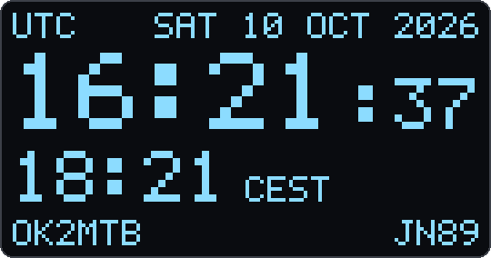
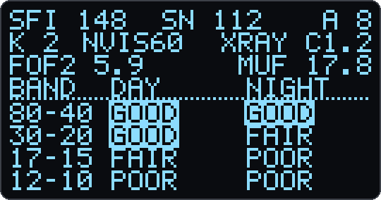
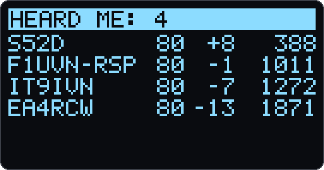
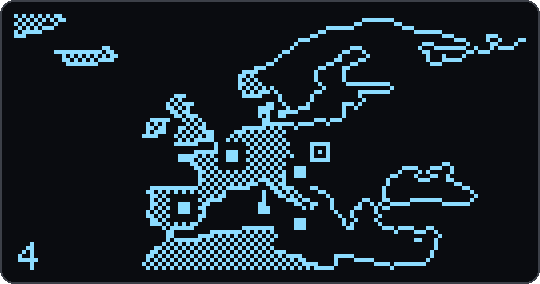

<div align="center">

# microHAMCLOCK

**A pocket-sized ham radio clock that shows who is hearing you, right now.**

UTC · propagation · nearest ionosonde · live PSKReporter spots on a list and a world map,
on the tiny OLED of a Heltec WiFi LoRa 32 V3.

[](LICENSE)




</div>

Call CQ on FT8, glance at your desk, and see the stations that decoded you pop up on the display,
with band, SNR and distance, and as dots on a map with the day/night terminator. Between QSOs it is a
clean UTC clock with solar data and a band recommendation for NVIS. No app, no account, no cloud of your
own: the board talks straight to public ham radio data feeds over Wi-Fi.

## Features

- 🕐 **Clock**: big UTC with seconds, date, and local time with automatic daylight saving time
  (about 50 city regions plus fixed UTC offsets).
- ☀️ **Propagation**: solar flux, sunspot number, A and K index, X-ray class and HF band conditions
  for day and night (N0NBH).
- 📡 **Nearest ionosonde**: foF2 and MUF(3000) from the closest GIRO ionosonde with a fresh
  measurement, picked automatically from your locator, plus the **recommended NVIS band**.
- 👂 **Who hears me**: live PSKReporter spots of your callsign over MQTT, any mode that gets
  decoded automatically (FT8, FT4, JS8, PSK, RTTY, CW…). Your `/P` and `/M` variants are included.
- 🗺️ **Map**: world and Europe views with the day/night terminator, plus optional Czechia,
  Germany, UK and USA maps. AUTO zooms to fit your spots, and new spots pulse.
- 🌙 **Kind to the OLED**: screen saver (off, Game of Life, or dim and shift), night mode, and an
  optional wake-up when a new spot arrives, with an LED flash if you like.
- 📱 **Easy setup**: install and set up in one browser page over USB, or from your phone through
  the board's own Wi-Fi hotspot. No passwords in the firmware, and entering setup never erases
  what you saved.
- 🌍 **Localized**: English, Czech and German on the display and the setup page, and easy to translate.
- 🪶 **Lightweight**: plain C++ on the Arduino core, with no external libraries.

## Screens

<table>
  <tr>
    <td align="center"><br><b>Clock</b><br>UTC, date, local time, callsign and locator</td>
    <td align="center"><br><b>Propagation</b><br>SFI, SN, A, K, NVIS band, X-ray, foF2, MUF, band conditions</td>
  </tr>
  <tr>
    <td align="center"><br><b>Heard me: list</b><br>callsign, band, SNR, km; sorted by time or distance</td>
    <td align="center"><br><b>Heard me: map</b><br>home square, spots, dotted land in daylight</td>
  </tr>
</table>

<sub>Screens rendered from the firmware's own font and map data, with example values.</sub>

## What you need

- A **[Heltec WiFi LoRa 32 V3](https://heltec.org/project/wifi-lora-32-v3/)** (ESP32-S3 with a
  0.96″ 128×64 OLED). The LoRa radio is not used.
- A USB-C cable and a 2.4 GHz Wi-Fi network.
- A USB charger or power supply. microHAMCLOCK is meant mainly for stationary use on your desk,
  plugged in all the time; a battery is not needed.
- Your callsign and Maidenhead locator.
- Optional, recommended: a 3D-printed case. The
  [Bender Battery Case for the Heltec V3](https://www.printables.com/model/797822-bender-battery-case-for-the-heltec-v3-heltec-t114)
  by zerofox3D on Printables fits well: it clips together without screws, keeps both buttons
  (PRG and RST) reachable, has a bay for an 18650 battery and an optional on/off switch. The
  model is free for personal use only, so please don't sell prints of it.

## Quick start

1. **Flash** it in one click: open the **[web installer](INSTALLER_URL)** in Chrome, Edge or
   Opera on a computer, plug in the board, press **Install**. That's it, no tools to install.

   <details><summary>Prefer to flash by hand?</summary>

   Download [`heltec_v3_microhamclock-merged.bin`](../../releases/latest/download/heltec_v3_microhamclock-merged.bin)
   (always the latest release; older ones are on the [releases page](../../releases)) and
   write it at address `0x0`, for example with [esptool-js](https://espressif.github.io/esptool-js/)
   or from the command line:
   ```
   esptool.py --chip esp32s3 write_flash 0x0 heltec_v3_microhamclock-merged.bin
   ```
   If the board does not connect, hold **PRG**, tap **RST** and release **PRG**.
   </details>

2. **Set it up** right on the same page: press **Connect to microHAMCLOCK**, pick your Wi-Fi from the
   list, enter the password, your callsign and locator, and **Save**. The page then shows the board
   connecting to Wi-Fi, getting the time and listening for your spots.

   No computer at hand? The board also starts a Wi-Fi hotspot called **MICROHAMCLOCK-xxxx**. Join it
   with your phone and the setup page opens by itself (or go to `http://4.3.2.1`).
3. **Get on the air**: call CQ in FT8 and watch the list fill up as stations hear you.
   (WSJT-X reports to PSKReporter about every 5 minutes.)

Need to change something later? **Hold PRG for 10 seconds** to get back to the setup page.

## Controls

One button, **PRG**:

| Press | Action |
|---|---|
| Short | next screen |
| Double | automatic screen switching on/off (15 s per screen by default) |
| Triple | status screen (Wi-Fi, IP, MQTT, data age, battery voltage, version) |
| Long (0.7 s) | list: sort by time or distance · map: AUTO → WORLD → EUROPE (→ CZECHIA → GERMANY → UK → USA, when switched on) · status screen: power off (**RST** starts the board again) |
| Hold 10 s | setup mode (hotspot) |

## Data sources and thanks

microHAMCLOCK only shows data that others kindly make public. Thank you to:

- **[PSKReporter](https://pskreporter.info/)** by Philip Gladstone, N1DQ, and its live
  **MQTT feed** by Tom Fanning, M0LTE: the reception reports.
- **[N0NBH](https://www.hamqsl.com/solar.html)**, Paul Herrman: solar and band condition data.
- **[KC2G](https://prop.kc2g.com/)**, Andrew Rodland, KC2G, who republishes the ionosonde
  measurements, and the **[GIRO](https://giro.uml.edu/)** ionosonde network (Lowell GIRO Data
  Center, University of Massachusetts Lowell) with the observatories that run the stations:
  foF2 and MUF measurements. The station in use is shown on the status screen, and the
  observatory contacts are in the GIRO
  [Acknowledgements List](https://giro.uml.edu/didbase/acknowledgements.html). GIRO data is
  released under [CC BY-NC-SA 4.0](https://giro.uml.edu/didbase/RulesOfTheRoad.html). Source:
  Reinisch, B. W., and I. A. Galkin, *Global Ionospheric Radio Observatory (GIRO)*, Earth,
  Planets and Space, 63, 377–381 (2011),
  [doi:10.5047/eps.2011.03.001](https://doi.org/10.5047/eps.2011.03.001),
  <http://spase.info/SMWG/Observatory/GIRO>.
- **[Natural Earth](https://www.naturalearthdata.com/)**: public domain map data.
- **NTP**: [ntp.ufe.cz](https://www.ufe.cz/) (the Czech national time standard), `tik.cesnet.cz`
  and `pool.ntp.org`.

## Building from source

The project uses [PlatformIO](https://platformio.org/):

```
pio run                               # build
pio run -t upload --upload-port COM4  # flash
pio device monitor                    # serial console, 115200 baud
```

The source layout, the console commands for testing, the map generator and the other tools are
described in [docs/development.md](docs/development.md).

## Translations

Display and web texts live in `src/lang/<code>.inc`, so a new language is mostly one file to
translate. Pull requests with new languages are very welcome; the steps are in
[CONTRIBUTING.md](CONTRIBUTING.md#translations).

## Documentation

- [Manual](docs/manual.md): installing, setup, screens, controls, screen saver and night mode,
  advanced settings, troubleshooting, data sources.
- [Development](docs/development.md): building from source, how it fits together, tools.
- [Changelog](CHANGELOG.md)

## About the name

microHAMCLOCK is a tribute to [HamClock](https://www.hamclock.com/) by Elwood Downey, WB0OEW (SK),
the clock that has graced so many shacks, which the community keeps going as
[OpenHamClock](https://github.com/openhamclock). microHAMCLOCK is a separate, much smaller project
with its own code. It is not affiliated with HamClock, the Clear Sky Institute or microHAM s.r.o.

## Made with AI assistance

microHAMCLOCK was designed and tested by OK2MTB and written with the help of AI: the code and
documentation were developed in conversation with Claude (Anthropic) in Claude Code. Every feature
was decided by a human and verified on real hardware.

## Contributing

Bug reports and pull requests are welcome. Before a pull request is merged, contributors agree once
to the [Contributor License Agreement](CLA.md): you keep the copyright, and the author may also
publish the project under other terms besides the GPL. Details are in [CONTRIBUTING.md](CONTRIBUTING.md).

## License

Copyright (c) 2026 Matěj "Wolf" Holyszewski, OK2MTB.

microHAMCLOCK is free software: you can redistribute it and/or modify it under the terms of the
[GNU General Public License](LICENSE) as published by the Free Software Foundation, either version 3
of the License, or (at your option) any later version. It is distributed in the hope that it will be
useful, but WITHOUT ANY WARRANTY; without even the implied warranty of MERCHANTABILITY or FITNESS FOR
A PARTICULAR PURPOSE.

The firmware binaries also contain the Arduino-ESP32 core (LGPL-2.1) and ESP-IDF components (mostly
Apache-2.0), under their own licenses. The map data is public domain (Natural Earth).

<div align="center">

**73 de OK2MTB**

</div>
